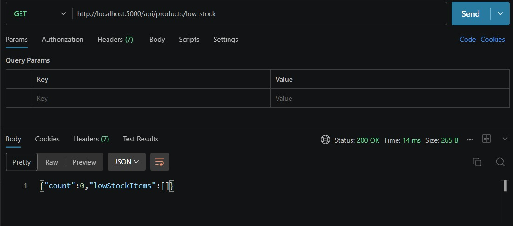
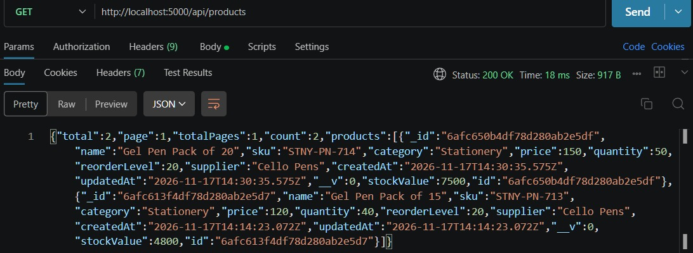
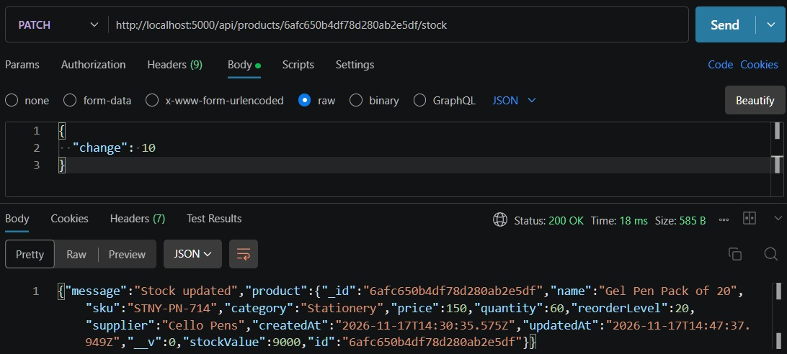
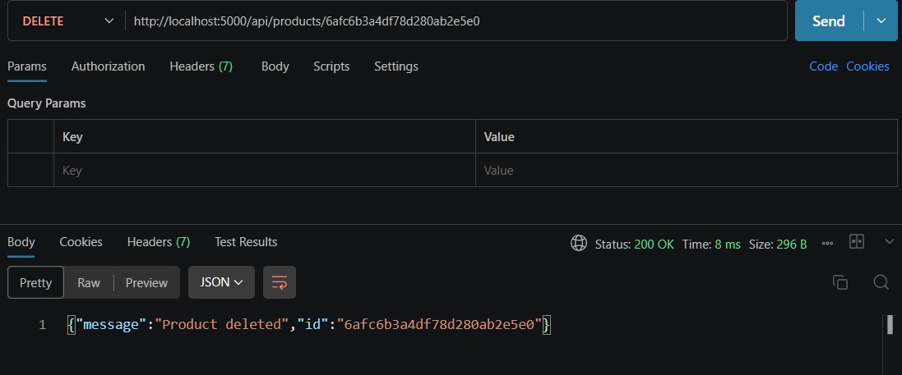

# Inventory Management System (Node.js, Express & MongoDB)

A RESTful backend API built for managing inventory products, categories, stock levels, and automated tracking using Node.js, Express, and Mongoose.

## 🚀 Tech Stack
* **Backend:** Node.js, Express.js
* **Database:** MongoDB & Mongoose
* **Testing Tool:** Postman

---

## 📌 API Endpoints & Testing Screenshots

### 1. Get All Products
* **Method:** `GET`
* **Endpoint:** `/api/products`
* **Description:** Retrieves the complete list of inventory items.
* **Screenshot:**
  

### 2. Get Low-Stock Products
* **Method:** `GET`
* **Endpoint:** `/api/products/low-stock`
* **Description:** Fetches items where stock is below the reorder level.
* **Screenshot:**
  

### 3. Update Stock
* **Method:** `PATCH`
* **Endpoint:** `/api/products/:id/stock`
* **Description:** Increments or decrements product stock quantity.
* **Screenshot:**
  

### 4. Delete Product
* **Method:** `DELETE`
* **Endpoint:** `/api/products/:id`
* **Description:** Removes a product by its unique ID.
* **Screenshot:**
  

---

## ⚙️ How to Run Locally
1. Clone the repository:
   ```bash
   git clone <repository-url>